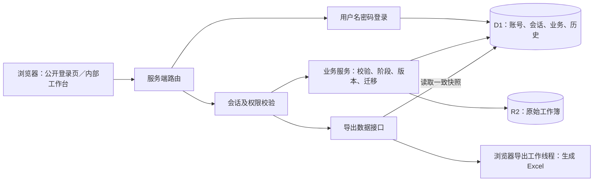
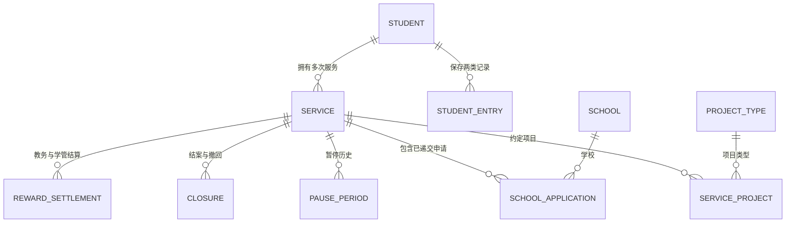
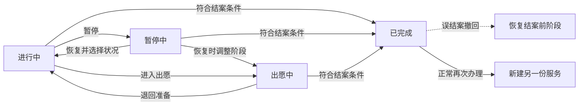

# S-Profile 系统架构设计

> 版本：1.0｜日期：2026-11-25（日本时间）｜状态：实施前架构文档
>
> 业务基线：[字段与流程确认.md](./字段与流程确认.md)。
> 本文说明如何实现已批准的第一版计划。文中的接口、数据表和技术默认约定属于实现设计，不代表功能已经开发或上线。

## 1. 目标与交付范围

建立内部团队共同维护的学生服务网站，承接现有 Excel 的四个阶段。核心是学生永久档案及完整历史：服务和阶段可以变化，已经发生的工作和修改记录持续保留。

第一版包含：普通账号登录、学生档案、服务管理、学校申请、两类跟进记录、暂停与结案、奖励结算年月、名册、搜索筛选、Excel 迁移核对及导出。

主界面一行一次服务；学生、服务、学校申请分别有稳定内部编号。学生姓名修改不会改变关联关系。

### 1.1 当前工程

| 项目 | 当前状态与实施方向 |
|---|---|
| 工程 | E:/AIJP/S-Profile/student-service |
| 前端及服务端 | 已有 Vinext、React、TypeScript 工程，业务首页仍为占位页 |
| 数据层 | 已有 Drizzle 接入文件，业务 schema 尚未建立 |
| 托管 | 已登记 Sites 站点，读取既有 .openai/hosting.json 的 project_id，复用站点 |
| 数据库与对象存储 | 实施时配置 D1 的 DB 绑定、R2 的 BUCKET 绑定 |
| 登录 | 用户名、密码；网站自己维护内部账号和会话，成员不依赖 ChatGPT 登录 |
| 文档 | 本架构与业务基线共同作为开发、迁移和验收依据 |

## 2. 系统分层

- 页面层负责表格、表单、时间线和核对交互。
- 业务层集中处理必填、枚举、阶段转换、合格条件、奖励归属及历史留存。
- 数据访问层负责关系约束、版本校验和批量事务。
- 所有业务接口、原文件下载和导出数据接口在服务端检查内部会话。
- 浏览器本地存储只保存显示偏好；学生、服务和历史以服务端为准。
- 托管平台的身份头不作为内部账号的替代，防止平台预览身份绕过普通账号登录。

### 2.1 技术选择

| 用途 | 方案 |
|---|---|
| 页面与路由 | 沿用现有 Vinext / React / TypeScript |
| 校验 | 共用业务校验定义；服务端是最终校验方 |
| 数据访问 | Drizzle + D1，追加式 schema 迁移 |
| 登录 | Better Auth 1.7.28，username / admin 功能 |
| 登录数据库适配 | @better-auth/drizzle-adapter 1.7.28 |
| 原始文件 | R2 私有对象，经鉴权接口下载 |
| Excel 读写 | ExcelJS 4.4.0；导出在浏览器工作线程中生成，减轻 Worker 内存压力 |
| 操作时间 | 服务端 UTC 时间戳，界面按 Asia/Tokyo 展示 |
| 业务年月／日期 | 分别保存 YYYY-MM、YYYY-MM-DD，避免补造每月1日 |

## 3. 核心数据关系

关系约束：

1. 签单年月、语言、所在地、当前学管在学生档案中保存，服务引用这些当前值。
2. 渠道、合同项目、目标专业、目标批次、当前教务和各项服务状态属于服务。
3. 学校入学时间、截止日、工作月份、合格日期和最终选择属于具体学校申请。
4. 两类记录只关联学生，以记录分类区分；不设置业务上的服务归属字段。
5. 当前人员、历史经办人员、奖励归属人员分别表达，人员交接不能覆盖奖励归属。
6. 原始导入记录通过来源关联追溯，不能直接作为正式学生或服务的主键。

## 4. 数据模型

以下为逻辑表设计。所有业务主表使用稳定 ID、版本号、创建时间和更新时间。实际 SQL 类型由 Drizzle schema 固化。

### 4.1 名册与账号

| 表 | 主要内容 | 约束 |
|---|---|---|
| staff_profiles | 业务人员姓名、教务／学管角色、是否停用 | 与登录账号分离；旧人员仍可被历史引用 |
| channels | 渠道机构名称、启用情况 | 名册选择及现场新增 |
| project_types | 项目类型名称、启用情况 | 初始八项；合同与实际申请使用同一名册 |
| schools | 学校标准显示名、启用情况 | 支持输入联想和新增 |
| school_aliases | 学校简称、其他写法与学校 ID | 已确认后关联，支持检索 |
| auth_user / auth_account / auth_session 等 | Better Auth 账号、凭据和会话 | 使用库生成 schema；密码和会话凭据不进入业务审计或业务导出 |

业务人员可没有登录账号；停用账号不会清除其历史操作。普通成员可维护业务名册，账号创建、停用和重置由管理员操作。

### 4.2 学生与语言

| 表 | 关键字段 |
|---|---|
| students | display_name、name_identity_key、first_order_month、manager_staff_id、current_location、language_declaration、version |
| student_language_results | student_id、exam_type、当前结果、version |
| entity_revisions | 实体类型／ID、版本、修改前后值、操作人、时间、动作类型 |

- name_identity_key 由显示名去除星号标记和空白后生成，建立唯一约束；显示名原文保留。
- 去除星号时同时处理附带的变体选择符，避免“⭐”与“⭐️”留下不可见的查重差异。
- 不以姓名文本建立外键，也不自动用同音、别名推断同一人。
- first_order_month 只表示学生首次接单月份。
- 语言声明区分已知有成绩、明确暂无成绩和历史资料待补。历史未知不能自动改成暂无成绩。
- 每种考试只有一份当前结果；更新时保存旧版本。JLPT使用等级，英语考试使用数值，不新增考试日期。
- 数值校验不擅自套用可能变化的考试分制上限。

### 4.3 服务与合同目标

| 表 | 关键字段 |
|---|---|
| services | student_id、channel_id、phase、student_status、teacher_staff_id、target_major、collection_state、production_state、application_progress、risk、publication_state、special_notes、general_notes、version |
| service_projects | service_id、project_type_id、当前是否采用、变更信息 |
| service_intake_targets | service_id、目标类别、intake_month、当前是否有效 |
| service_events | service_id、事件类型、前后阶段、业务快照、操作人、发生时间、登记时间 |

原合同目标与当前目标分别保存；初始当前目标取原合同目标。延期时显式填写新目标，原合同目标保持可追溯。合同项目增减保存历史，并保留已经建立的学校申请。

学生状况在未结案服务中表达当前状况。结案时保存结束前状况快照，完成页面以结案类型表示结束情况；撤回时恢复结案前状况。暂停时的原状况另存在暂停记录中。

服务表中的结束前状况继续保留；完成页面将它作为历史展示。暂停阶段与当前状况的一致性校验适用于未结案服务，不把完成记录中的历史暂停值显示为当前暂停。

### 4.4 学校申请

| 字段组 | 关键字段与约束 |
|---|---|
| 归属 | service_id、school_id |
| 项目 | project_type_id 必填；program_name 选填 |
| 时间 | intake_month、deadline_date、work_start_month，均允许待定 |
| 合格 | 是否已登记正式合格、admission_received_on；新增合格必须有具体日期 |
| 最终选择 | is_final_choice，可多条为真；选择对象是合格申请 |
| 内诺 | requires_informal_offer 由老师判断；最终选择且需要内诺时，informal_offer_month 必填 |
| 历史 | version、作废标记、来源引用 |

- 仅为已实际递交的申请建记录；同校多项目、批次允许多条。
- 未登记合格不等于不合格，界面不能据此显示失败结论。
- 学校入学时间独立于服务合同目标。
- 出愿工作月份是开始办理月份；不增加实际递交日期的强制字段。
- 多条最终选择分别维护内诺年月；取消最终选择时，旧值通过版本历史保留。
- 学校记录作废不物理删除，不自动改服务阶段。

### 4.5 跟进、暂停、结案与奖励

| 表 | 关键字段与用途 |
|---|---|
| student_entries | student_id、kind（常规／出愿）、body、date_value、date_precision、登记时间、version、作废标记 |
| pause_periods | service_id、暂停前阶段／状况、原因、暂停及恢复时间、version |
| closures | service_id、kind、说明、目标快照、结案前阶段／状况／暂停关联、结案时间、登记时间、撤回信息 |
| reward_settlements | service_id、角色（教务／学管）、recipient_staff_id、归属确认信息、payroll_month、version |

日志日期精度支持日、年月、未知。新记录采用日精度；旧记录保留实际掌握的精度，只有月份而无年份时保持日期未知和原始日期文字。

一份服务可以有多次暂停及结案纠错历史，同时至多有一个有效结案。结案撤回只恢复阶段相关状态，不回滚结案后对语言、姓名、记录、学校或人员等作出的其他修改。

每次服务的每个奖励角色只有一份当前结算记录。未确认归属时显示当前负责人的建议值；保存确认后固定归属，之后人员交接不再改变它。归属人与当前负责人分开展示。

### 4.6 迁移来源与待核项

| 表 | 关键内容 |
|---|---|
| import_batches | 原文件名、文件摘要、R2对象键、上传人、登记时间、解析版本 |
| source_rows / source_cells | 工作表、坐标、原始值、显示文本、日期格式、隐藏标记、合并区域、颜色和其他来源信息 |
| import_issues | 问题类型、原内容、建议值、待核状态、确认人及时间 |
| source_mappings | 来源记录到学生、服务、申请、日志等实体的关联 |
| legacy_field_exceptions | 尚未补齐的历史字段、原始来源及缺失原因 |

历史例外按字段记录。无关字段修改不强迫补齐整份旧资料；主动填写某个字段时执行该字段规则。补齐后不再享有该字段的缺失例外。

学生身份或服务归属无法确定的原记录留在核对区，不制造“未知学生”正式档案。

## 5. 字典和日期约定

| 技术字段 | 业务取值 |
|---|---|
| phase | progress＝进行中；paused＝暂停中；applying＝出愿中；completed＝已完成 |
| student_status | not_started＝未开始；on_contract＝当期申请；deferred＝延期；paused＝暂停中 |
| application_progress | 未开始、发邮件中、研究计划、拿到内诺、出愿中、出现问题、完成申请、确定退款 |
| closure_kind | admission＝学校结果；refund＝退款；abandoned＝学生放弃；closed_other＝其他已结单 |
| entry_kind | progress＝常规进度；application＝出愿情况 |
| date_precision | date＝具体日期；month＝年月；unknown＝未知 |

完整业务枚举、初始名册和必填条件以字段确认稿为准。历史原值不在新枚举中的，保留原文并进入核对，不强行替换成默认值。

YYYY-MM 不是某月1日；业务日期不做跨时区偏移。系统操作时间与历史业务发生时间分别保存：导入时间不能充当旧记录的发生时间。

## 6. 阶段与业务校验

### 6.1 转换规则

| 动作 | 校验与数据变化 |
|---|---|
| 暂停 | 原阶段必须为进行中；保存前状况和选填原因；阶段、状况同步暂停 |
| 恢复 | 默认原阶段、允许调整；明确选择学生状况；若选择延期须有新目标 |
| 进入出愿／退回进行中 | 人工切换，保留全部工作、学校、日志；不强制要求已经有学校记录 |
| 结案 | 四类单选；保存当前有效入学目标及结束前状态快照 |
| 撤回误结案 | 全员可直接操作，无原因或审批字段；保留结案事件及撤回记录 |
| 正常续办 | 创建新服务，原服务维持完成，学生档案和两类日志继续共享 |

历史直接导入已完成且没有已知前阶段时，撤回的技术默认目标为进行中；来源中未知的前阶段仍标未知，不伪造原流转事件。该默认值属于实现约定。

暂停表示停止常规服务工作，不把历史资料锁死；纠错、查阅和恢复、退款等必要维护仍可操作。

暂停只作用于当前服务。同一学生的其他服务按各自阶段办理，两类学生日志继续作为共享资料维护。

### 6.2 关键校验

- 真实开始联系教授、拿到内诺、正式出愿或合格后，学生状况不能仍是未开始。
- 研究计划制作可以早于正式申请；出现问题、确定退款不自动说明申请已开始。
- 材料收集与制作、制作与教授联系之间不设置强制先后。
- 申请进度、申请风险由人工维护，不自动驱动阶段。
- 学校结果结案需要至少一条正式合格申请；最终去向可之后补充。
- 退款结案表达已全部退清，并要求文字说明；不执行实际付款。
- 学生放弃要求明确终止且不退款；没有回复不自动产生放弃结论。
- 尾款和奖励结算不阻止结案。
- 补充协议不消除原合同目标及延期历史。

## 7. 永久历史与多人协作

### 7.1 当前值与历史

每个可编辑业务实体保留当前版本，同时追加旧值、操作人、时间和动作。学校、日志的作废保留原文；实体关联调整保留原来源。用户可查看历史，但不能通过普通编辑改写历史版本本身。

学生公共字段变化通过引用同步显示，不批量复制到每份服务。已完成页展示当前教务、学管；结案目标使用当时快照；奖励使用已确认归属。

### 7.2 并发保存

1. 前端读取实体及 version。
2. 修改时提交 expectedVersion。
3. 服务端在同一批事务中校验版本、写入当前值、增加版本及审计记录。
4. 版本不符返回409；界面保留用户输入，展示最新数据供重新核对。
5. 新增日志使用独立 ID，避免用整段文字覆盖其他人的记录。

D1采用批量事务提交；不能仅先查版本再分开写数据和审计。事务中需要版本保护，任何失败都不留下半套更新。变更学校、合同项目等子数据时同步校验所属服务版本，防止与结案校验发生竞态。

追加接口使用请求幂等标识，重复点击或重试不重复新增日志、学校或结案事件。

## 8. 页面结构

| 页面 | 内容与主要操作 |
|---|---|
| 登录 | 用户名、密码；登录失败使用统一提示 |
| 服务工作台 | 四阶段切换，一行一次服务；搜索、筛选、查看、新增、导出 |
| 学生档案 | 按姓名查找永久档案，查看服务数量，打开学生详情 |
| 学生详情 | 展开语言成绩，维护学生资料、学生跟进和出愿跟进。切换服务可办理阶段、编辑工作进度、登记学校申请和查看备注。变更历史支持该生全部记录或仅当前服务 |
| 奖励结算 | 每份服务一行，可按学生、奖励归属人和工资年月查找，分别维护教务与学管奖励 |
| 学校申请编辑 | 学校联想、项目、入学时间、截止日、工作月份、合格、最终选择、内诺 |
| 结案操作 | 四类型单选及对应说明，显示结案条件 |
| 管理后台 · 导入核对 | 管理员核对原表内容与整理建议、匹配学生与服务、补充缺失字段、确认冲突 |
| 名册 | 渠道、教务、学管、项目、学校的维护 |
| 账号管理 | 管理员创建、停用、重置账号 |
| 历史查看 | 查看字段旧值、原日志、作废内容、阶段事件和来源 |

工作台默认显示进行中。采用中文表格、固定姓名列、清晰的表单分区；手机支持查看和必要编辑。

搜索覆盖姓名和记录正文；筛选围绕当前视图的结构化字段，条件默认取交集。学校子列表按截止日期升序，空日期置后。服务主列表默认按最近更新排序，可切换排序。

两个列表共用学生详情。从服务工作台进入时选中所点的合同。从学生档案进入时优先打开最近更新的进行中或出愿中服务，其次是暂停及已完成服务。每份服务分别保存工作进度与学校申请，学生跟进与出愿跟进各有一条跨服务共用的时间线。完成页按四种完成类型显示对应内容，全部合格申请可展开查看。

## 9. 接口边界

接口使用同源 JSON 请求；所有业务响应采用禁止共享缓存的设置。以下路径为实现约定：

| 方法与路径 | 用途与约束 |
|---|---|
| POST /api/auth/sign-in/username | 用户名密码登录 |
| /api/auth/* | 仅开放所需认证能力；关闭公开注册和非必要账号能力 |
| GET/POST /api/students | 查询、新建永久档案 |
| GET/PATCH /api/students/:id | 学生详情、共有字段修改及版本校验 |
| POST /api/students/:id/services | 为已有学生新增服务 |
| GET/PATCH /api/services/:id | 服务详情及普通字段修改；阶段通过动作接口处理 |
| POST /api/services/:id/actions/:action | 暂停、恢复、进入出愿、退回、结案、撤回 |
| GET/POST /api/services/:id/applications | 学校申请列表及新增 |
| PATCH /api/applications/:id | 学校申请、合格、最终选择与内诺修改 |
| POST /api/applications/:id/void | 作废申请并保留历史 |
| GET/POST /api/students/:id/entries | 按分类／年月查阅或新增记录 |
| PATCH /api/entries/:id | 修改记录，追加版本 |
| POST /api/entries/:id/void | 作废记录并保留原文 |
| PUT /api/services/:id/rewards/:role | 保存对应角色的奖励归属及工资年月 |
| GET /api/history/:entityType/:id | 分页查看业务历史 |
| /api/catalogs/:kind | 维护业务名册 |
| POST /api/imports | 保存原工作簿、解析为来源与待核项 |
| GET /api/imports/:id/review | 核对原文、建议和业务关联 |
| POST /api/imports/:id/resolve | 确认映射或纠正建议，留审计及来源 |
| GET /api/imports/:id/original | 管理员下载原工作簿 |
| POST /api/exports | 取得当前筛选或完整导出数据快照 |
| /api/admin/users | 管理员管理账号 |

客户端不决定操作人、审计时间、账号角色或历史导入例外。服务端不接受通过普通字段修改接口跳过阶段动作校验。

401 表示未登录，403 表示当前账号缺少操作权限，404 表示记录不存在，409 表示版本或唯一性冲突，422 表示业务字段或动作不满足条件。错误返回字段定位，便于直接修正。

## 10. 登录与权限

| 能力 | 管理员 | 普通成员 | 未登录 |
|---|---|---|---|
| 查看、修改全部业务资料 | 是 | 是 | 否 |
| 新增服务、维护学校与名册 | 是 | 是 | 否 |
| 日志修改、作废、查看历史 | 是 | 是 | 否 |
| 结案、直接撤回误结案 | 是 | 是 | 否 |
| 导入核对及原件下载 | 是 | 否 | 否 |
| 资料导出 | 是 | 是 | 否 |
| 创建、停用、重置账号 | 是 | 否 | 否 |
| 打开登录页 | 是 | 是 | 是 |

### 10.1 技术默认约定

- 首个管理员通过短期一次性初始化凭证设置账号；成功后关闭首次初始化入口，不提供固定默认密码。
- 后续账号由管理员创建；成员可以修改自己的密码，停用及重置时撤销相关会话。
- 用户名作为登录标识，姓名作为显示信息；不要求成员提供 ChatGPT 账号。
- Better Auth 所需的内部邮箱标识由服务端生成不可投递的唯一值，不成为产品必填项、不用于发邮件或登录界面。
- 账号密码只保存库提供的安全散列；凭据、Cookie、初始化密钥不进入业务日志、文档或导出。
- 会话 Cookie 使用 HTTPS、HttpOnly 和合适的 SameSite 设置；保留 CSRF 和来源校验。
- 账号状态在请求中检查，停用后不能继续通过旧会话访问。
- 业务原文以文本显示；服务端不执行工作簿、备注或日志中的指令。
- 生产数据不能进入公开前端构建文件或共享缓存。

## 11. Excel 迁移设计

### 11.1 流程

解析后先形成可追溯的来源记录，再建立规范实体。原始文件与来源单元格不可被业务编辑覆盖。

### 11.2 各表映射

| 原表 | 迁移要点 |
|---|---|
| 进行中 | 学生公共字段与服务字段拆开；R～Y整理为常规进度；被删除字段仍在来源中 |
| 暂停中 | 状况、暂停说明和历史进度分别处理；L列混有人名和所在地，Q～T按内容核对 |
| 出愿中（学生管理） | N进入学生级出愿记录；学校拆为申请记录；校级时间与合同目标分开；紧急度合并状况；空申请进度列不新增业务字段 |
| 已完成 | A对应结束时目标；B对应出愿工作开始月；J/K分别处理内诺月与收到合格日期；L四类完成情况；M解析结算人与工资年月，保留原文 |
| 全表隐藏及散落内容 | 保留隐藏标记、坐标、合并关系及原文，不能因没有表头而丢弃 |

### 11.3 核对类型

- 同名跨表：是否同一学生，以及同一次服务的历史还是不同服务。
- 星号、别名、真实同名：依据确认后的姓名规则处理，不能直接按名字合并全部资料。
- 列错位、同列多含义、跨学生合并单元格。
- 原签单月份冲突：提出候选，由人工确认首次接单月份。
- 日期缺年份、正文与表头年份冲突、只有月份、非日期文字。
- 只有“有英语成绩”而没有考试类型或分数。
- 校名中混有说明、未合格记录写入完成表、退款或放弃与学校文字并存。
- 结算文字缺年份、历史人员与当前人员不一致。
- 学校仅有意向或内诺、尚未实际递交：原文保留，不能直接转成已递交学校记录。

相同文件摘要与来源位置建立幂等约束。重新导入同一来源可复用核对结果；不同文件版本先建立匹配建议，不直接覆盖既有实体。

## 12. 导出设计

### 12.1 文件组成

当前筛选导出保留当前服务列表的行、筛选条件及显示信息。

完整资料导出包含四阶段服务表、学生档案、学校申请、常规进度、出愿情况、历史变更以及原始来源／待核明细。业务数据与账号凭据分离。

日志表按学生汇总，列名使用完整年月。每条记录保留业务日期、正文及必要来源说明。两类日志分别成表，同一学生多份服务不重复导出同一条日志。

### 12.2 完整性约定

- 日期不明的数据单设“日期待确认”列或明细，不猜年份。
- 年月字段以年月文字导出，不写成虚构的1日。
- 超过单元格字符或换行限制时生成续行，保留学生标识和完整内容。
- 表规模超过 Excel 限制时拆分工作表或文件，保留索引，不静默截断。
- 用户文字按文本单元格写入，防止被解释成公式。
- 导出接口按一致的数据版本取得快照；浏览器工作线程负责排版生成文件，结束后释放内存。

## 13. 验收与实施顺序

| 验收范围 | 必须覆盖的情况 |
|---|---|
| 永久档案 | 一名学生多个服务；姓名修改同步；星号及空白查重；同名导入待核 |
| 目标与延期 | 多批次满足任意一个仍当期；补签不抹除延期；学校时间不影响合同目标 |
| 工作进度 | 边收集边制作、边制作边发邮件；实际申请开始后状况校验；进度不自动改阶段 |
| 阶段 | 暂停、恢复、出愿退回；结案四类型；直接撤回无原因；正常再办新增服务 |
| 学校 | 同校多项目／批次；任意一校合格可结案；多条最终选择及各自内诺月 |
| 人员和奖励 | 当前人员变化、历史经办保留、已确认奖励归属固定、结算空月不视为欠发 |
| 权限 | 未登录、停用、普通成员调用账号管理；所有下载与导出鉴权；无公开数据缓存 |
| 并发与历史 | 版本冲突保留输入；同批写数据和审计；重复请求幂等；日志作废可追溯 |
| 迁移 | 四表与隐藏行、错位和合并单元格、日期与语言未知、来源保留、重复导入 |
| 导出 | 当前筛选与完整资料、多年同月、两类记录、超长文本、未知日期、公式文本 |

实施顺序：

1. 建立领域类型、数据 schema、初始名册及字段校验。
2. 完成账号、会话、业务鉴权、版本和审计基础。
3. 完成四阶段工作台、学生档案和服务详情。
4. 完成学校、两类记录、暂停结案、奖励和历史界面。
5. 完成原文件保存、四表迁移及导入核对页。
6. 完成 Excel 导出和权限、并发、业务测试。
7. 用实际工作簿验证完整性，浏览器验证主要操作后发布。

schema 迁移只包含有界的结构变更；名册和学生资料通过独立、幂等的数据流程写入。发布复用现有站点，先验证访问控制，再开放公开登录入口。

## 14. 参考与维护

- [已确认字段与流程](./字段与流程确认.md)
- [Better Auth 用户名功能](https://better-auth.com/docs/plugins/username)
- [Better Auth 管理员功能](https://better-auth.com/docs/plugins/admin)
- [Better Auth Cloudflare 指引](https://better-auth.com/docs/guides/cloudflare)
- [Better Auth Drizzle 适配](https://better-auth.com/docs/adapters/drizzle)
- [ExcelJS 项目文档](https://github.com/exceljs/exceljs)

后续业务变更先更新字段确认稿，再同步本架构、数据迁移和验收场景。架构中的技术默认约定可以在实施中按实际验证结果调整，但不得改变已确认的字段含义、归属和保留规则。
